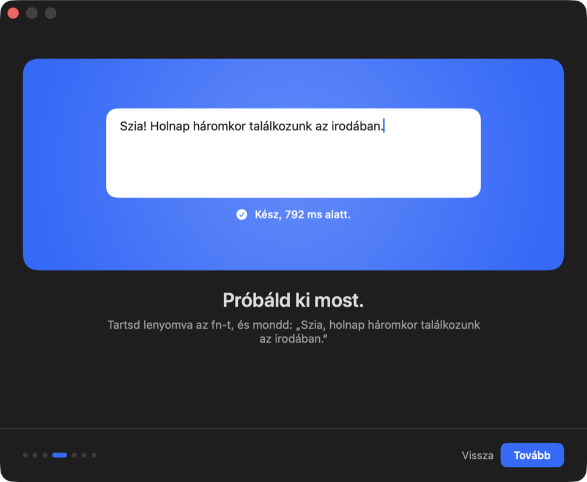

# Pusmogo

**Pusmogo** (Hungarian *pusmogó*, "the whisperer"; said *PUSH-mo-go*): push, talk, go.

Free, open-source voice dictation for macOS, Hungarian first. Hold a key, speak Hungarian or English, let go, and the text appears where your cursor is, in any app. Everything runs on your Mac: no account, no cloud, no subscription. The app is about 9 MB; the speech models download once, 574 MB each: Whisper large-v3-turbo for English, and [Pusmogo HU](https://huggingface.co/vatsonai/pusmogo-hu-001), the same model trained further on Hungarian speech, for Hungarian.

Made by [vatson.ai](https://vatson.ai).

[](https://github.com/clausis-ai/pusmogo/releases/latest/download/Pusmogo.dmg)

> **Status:** beta, for Macs with Apple Silicon. Download it from [Releases](https://github.com/clausis-ai/pusmogo/releases/latest), or build it from source as below.

*Magyarul lent: [Röviden magyarul](#röviden-magyarul).*



## What it does

- **Hold fn, talk, release.** The text is typed into the focused field: native apps, browsers, editors. If a field can't take it, the text stays on the clipboard and the bar tells you so; a dictation is never lost.
- **Hungarian or English, your choice.** fn + ⇧ swaps the language; the bar shows `HU` or `EN`. There is no automatic language detection: you always get the language you picked.
- **Fast.** A short dictation is typed about 0.6–0.8 s after you release the key on an Apple Silicon Mac. Long dictations are transcribed in pieces while you talk, so the wait stays short ([stream-04](docs/bench/stream-04.md)).
- **Clean text.** Sentence casing, punctuation, Hungarian number suffixes ("15%-al" → "15%-kal"), stutters dropped. Spoken commands work in both languages: "vessző", "pont", "kérdőjel", "új sor" / "comma", "period", "new line".
- **Your words.** A dictionary for names and jargon, a searchable history with a retention setting, a second push-to-talk key, a microphone picker, launch at login.
- **Says what you meant.** A spoken self-correction keeps only the fix ("holnap háromkor, nem, négykor" → "holnap négykor"; History still shows what you said, and Settings can turn it off). Spoken lists ("először …, másodszor …", "first …, second …", "bullet point …") become numbered or bulleted lines.
- **Learns from your fixes.** Correct a dictated word right after it is typed and Pusmogo offers to add it to the dictionary; fix the same word the same way twice and it is added on its own, with Undo.
- **Writing style per app.** Chats, work messages, email and code editors each get their own style (formal, casual, very casual); in email a spoken greeting and sign-off go on their own lines, and in editors spoken case commands type identifiers ("camel case user id" → `userId`).
- **Snippets and insights.** Say a trigger phrase to type a saved text; a local Insights tab shows your words, pace and streaks. Nothing leaves your Mac.
- **Local AI apps.** A bundled MCP server lets Claude Desktop, Claude Code or Cursor clean text, and, only if you turn sharing on, read your history, dictionary and snippets.
- **Hungarian or English interface**, following your macOS language.

## Install from a disk image

There is no published download yet. To make the disk image yourself, build as in [Install from source](#install-from-source), then:

```bash
brew install create-dmg   # MIT; lays out the disk image window
./scripts/make-dmg.sh     # builds the app, then build/Pusmogo.dmg (about 5 MB)
```

Open `Pusmogo.dmg` and drag Pusmogo onto the Applications folder. If you start it from somewhere else (Downloads, the disk image), Pusmogo offers once to move itself into Applications. The image is not signed or notarised yet, so on a Mac that downloaded it macOS refuses the first launch: open *System Settings → Privacy & Security* and click *Open Anyway* next to Pusmogo. The background is a placeholder drawn by `app/dmg/background.swift`.

## Install from source

You need:

- macOS 14 or newer to build; Apple Silicon recommended (Intel builds are not tested yet). The app itself targets macOS 13 or newer, not yet tried on macOS 13
- Xcode command line tools: `xcode-select --install`
- Rust via [rustup](https://rustup.rs)
- `cmake`: `brew install cmake`

```bash
git clone https://github.com/clausis-ai/pusmogo.git
cd pusmogo
./scripts/build.sh --whisper   # the first build compiles whisper.cpp and takes a few minutes
open build/Pusmogo.app
```

On first launch a short setup window walks you through:

1. **Microphone** and **Accessibility** permissions. Accessibility is what lets Pusmogo see the fn key and type into other apps.
2. **The fn key.** Set *System Settings → Keyboard → Press 🌐 key to: Do Nothing*, otherwise fn also opens the emoji picker or switches the keyboard layout. The setup window has a button for this. On a keyboard without fn, pick a second key (Right ⌥, Right ⌘ or Right ⌃) in Settings.
3. **The speech model.** Pusmogo downloads [`ggml-large-v3-turbo-q5_0.bin`](https://huggingface.co/ggerganov/whisper.cpp) (574 MB) from Hugging Face into `~/Library/Application Support/Pusmogo/models/`. English uses it. Hungarian uses [`ggml-pusmogo-hu-q5_0.bin`](https://huggingface.co/vatsonai/pusmogo-hu-001) (574 MB): it downloads in the background after turbo, and dictation uses turbo until it arrives. Settings → model lets you pick another model per language; your choice always wins. To fetch turbo yourself instead:

   ```bash
   mkdir -p ~/Library/Application\ Support/Pusmogo/models
   curl -L -o ~/Library/Application\ Support/Pusmogo/models/ggml-large-v3-turbo-q5_0.bin \
     https://huggingface.co/ggerganov/whisper.cpp/resolve/main/ggml-large-v3-turbo-q5_0.bin
   ```

   It also fetches the [Silero speech detector](https://huggingface.co/ggml-org/whisper-vad) `ggml-silero-v5.1.2.bin` (≈ 0.9 MB, MIT) into the same folder, so noise alone never reaches Whisper. It is optional: without it, dictation works the same, only slower on noise.

4. **Try it** in the window itself, before you use it anywhere else.

Pusmogo lives in the menu bar (no Dock icon). Click its icon for Home, History, Dictionary and Settings.

**Rebuilding.** The build is signed ad hoc, so macOS treats every rebuild as a new app and asks for Accessibility again (remove the old entry under *Privacy & Security → Accessibility*, then add the new one). To keep the permission across rebuilds, sign with a free Apple Development certificate: `PUSMOGO_SIGN_ID="Apple Development: …" ./scripts/build.sh --whisper`.

`./scripts/build.sh` without `--whisper` builds a stub engine with no speech recognition. It is for UI work and needs no cmake. `./scripts/build.sh --universal` builds one app for Apple Silicon and Intel (run `rustup target add x86_64-apple-darwin` first); the Intel half has not been run on an Intel Mac yet.

## Shortcuts

| Keys | What it does |
|---|---|
| hold **fn** | dictate; release to insert the text |
| **fn** twice | hands-free: talk as long as you like, press fn again when done |
| **fn** three times | cancel hands-free |
| **fn + Space** | switch to hands-free while holding fn |
| **fn + ⇧** | Hungarian ⇄ English |
| **Esc** | cancel the dictation |
| **⌃⌘V** / **⌃⌘C** | paste / copy the last dictation again |
| **⌃⌥P** | open the Pusmogo panel (History, Dictionary, Settings), handy when a full menu bar hides the icon behind the notch |
| hold **Right ⌥ / ⌘ / ⌃** | same as fn, if you turn it on in Settings |

## Privacy

- Audio is processed in memory on your Mac and never stored or sent anywhere.
- Pusmogo connects to the internet for two things only: the one-time model downloads from Hugging Face, and a check for a new version on GitHub (Settings can turn the check off).
- Context hints: when you start a dictation, Pusmogo reads the text before the cursor in the focused field (Accessibility, no screenshots) so names and terms already there are spelled right. The text is used for that one dictation only and is never stored or logged. Turn it off in Settings ("Use surrounding text").
- History and dictionary are plain text in a local SQLite file, `~/Library/Application Support/Pusmogo/profile.sqlite`. You can search and delete entries, clear everything, or keep history for 7, 30 or 90 days only.
- A timing log (`~/Library/Logs/Pusmogo/timings.jsonl`) keeps durations and character counts, never the text.
- No analytics, no telemetry, no account.

## Accuracy and speed

Measured on an Apple Silicon Mac (M5 Pro, Metal), warm engine, with the model each language uses by default. "Latency" is the transcription time. Details and how to rerun: [docs/bench/train-01.md](docs/bench/train-01.md).

| Set | Model | Clips | WER | Latency p50 |
|---|---|---|---|---|
| Hungarian, real speech ([FLEURS](https://huggingface.co/datasets/google/fleurs) test) | Pusmogo HU | 100 | 12.5 % (CER 3.3 %) | 0.29 s |
| Hungarian, short phrases, synthetic voice | Pusmogo HU | 44 | 12.0 % (CER 3.4 %) | 0.17 s |
| Hungarian, synthetic voice | Pusmogo HU | 60 | 5.5 % | 0.21 s |
| Hungarian–English mixed, synthetic voice | Pusmogo HU | 30 | 24.2 % | 0.20 s |
| English, real speech (FLEURS test) | large-v3-turbo | 100 | 5.9 % (CER 2.6 %) | 0.25 s |
| English, synthetic voice | large-v3-turbo | 20 | 0.0 % | 0.20 s |

Most Hungarian word errors are a letter or two off, or a compound written as two words, which is why the character error rate is much lower. Hungarian sentences with English terms are the known weak spot. The synthetic sets use macOS text-to-speech voices; they track changes well but flatter real speech.

## How it is built

- `app/`: the Swift menu bar app: hotkeys, audio capture, the sound bar, text insertion, onboarding and the panel.
- `core/crates/pusmogo-core`: the Rust core: [whisper.cpp](https://github.com/ggml-org/whisper.cpp) engine with Metal, streaming, text cleanup, the local profile, and a C ABI ([`core/include/pusmogo.h`](core/include/pusmogo.h)) the app calls.
- `core/crates/pusmogo-bench`: the accuracy and latency benchmark.
- `core/crates/pusmogo-mcp`: a stdio MCP server for local AI apps: `clean_text`, and read-only `search_history`, `get_dictionary` and `list_snippets` (each works only after you turn on sharing in Settings → AI apps). The app carries a copy at `Pusmogo.app/Contents/MacOS/pusmogo-mcp`, built without the speech engine to keep the app small. For `transcribe_file` too, build the full server:

  ```bash
  cd core && cargo build --release -p pusmogo-mcp --features whisper
  claude mcp add pusmogo --env PUSMOGO_MODEL="$HOME/Library/Application Support/Pusmogo/models/ggml-large-v3-turbo-q5_0.bin" -- "$PWD/target/release/pusmogo-mcp"
  ```

## Röviden magyarul

A Pusmogo ingyenes, nyílt forráskódú diktálóprogram macOS-re. Tartsd lenyomva az fn-t, beszélj magyarul vagy angolul, engedd el, és a szöveg ott jelenik meg, ahol a kurzor áll. Minden a gépeden fut: nincs fiók, nincs felhő, nincs előfizetés.

- **Telepítés:** töltsd le a [kiadások](https://github.com/clausis-ai/pusmogo/releases/latest) közül, és húzd az Alkalmazások mappába (Apple Silicon Mac kell hozzá). Első indításkor egy rövid ablak végigvezet az engedélyeken (Mikrofon, Kisegítő hozzáférés), letölti a beszédmodellt (574 MB), és ki is próbálhatod. A magyarhoz a háttérben letölti a Pusmogo HU modellt is (574 MB); a Beállításokban nyelvenként másikat is választhatsz.
- **Billentyűk:** fn nyomva tartva: diktálás · fn kétszer: kihangosítva, fn újra: kész · fn + ⇧: magyar ⇄ angol · Esc: mégse · ⌃⌘V: utolsó szöveg újra · ⌃⌥P: a panel, ha a menüikon nem látszik.
- **Önjavítás és felsorolás:** ha diktálás közben javítod magad, csak a javítás marad („holnap háromkor, nem, négykor” → „holnap négykor”; az Előzményekben látod, mit mondtál, és a Beállításokban kikapcsolható). A kimondott felsorolás („először …, másodszor …”, „listapont …”) számozott vagy pontokba szedett sorokká válik.
- **Tanul a javításaidból:** ha a beírt szöveg egy szavát rögtön kijavítod, felajánlja, hogy felveszi a szótárba; ha ugyanazt a szót kétszer ugyanúgy javítod, magától felveszi, visszavonhatóan.
- **Stílus alkalmazásonként:** a személyes és munkahelyi üzenetek, az e-mail és a kódszerkesztők külön stílust kapnak (formális, laza, nagyon laza); e-mailben a kimondott megszólítás és elköszönés külön sorba kerül, kódszerkesztőben a kimondott parancsok azonosítót írnak („camel case user id” → `userId`).
- **Gyorsszövegek és statisztika:** mondd ki egy gyorsszöveg kulcsszavát, és a mentett szöveg jelenik meg; a Statisztika lapon látod a szavaid számát, a tempódat és a sorozataidat. Semmi nem hagyja el a gépet.
- **Helyi AI-alkalmazások:** a beépített MCP-szerveren át a Claude Desktop, a Claude Code vagy a Cursor szöveget tisztíthat, és csak ha bekapcsolod a megosztást, olvashatja az előzményeidet, a szótáradat és a gyorsszövegeidet.
- **Nyelv:** te választod (fn + ⇧), automatikus nyelvfelismerés nincs. A felület magyarul vagy angolul jelenik meg, a macOS nyelvétől függően.
- **Adatvédelem:** a hang nem hagyja el a gépet, és nem is mentjük. Az előzmények és a szótár csak helyben, egy SQLite fájlban vannak. Diktáláskor a kurzor előtti szövegből tanul neveket és szakszavakat; ezt csak arra az egy diktálásra használja, nem menti el, és a Beállításokban kikapcsolható („Szövegkörnyezet használata”).

## Contributing

Contributions are welcome: see [CONTRIBUTING.md](CONTRIBUTING.md) and the [Code of Conduct](CODE_OF_CONDUCT.md). Coding agents start at [AGENTS.md](AGENTS.md). Report security issues privately as described in [SECURITY.md](SECURITY.md).

## Licence

Licensed under [Apache-2.0](LICENSE). "Pusmogo" and "vatson.ai" are our names; forks need a different one (see [NOTICE](NOTICE)).
